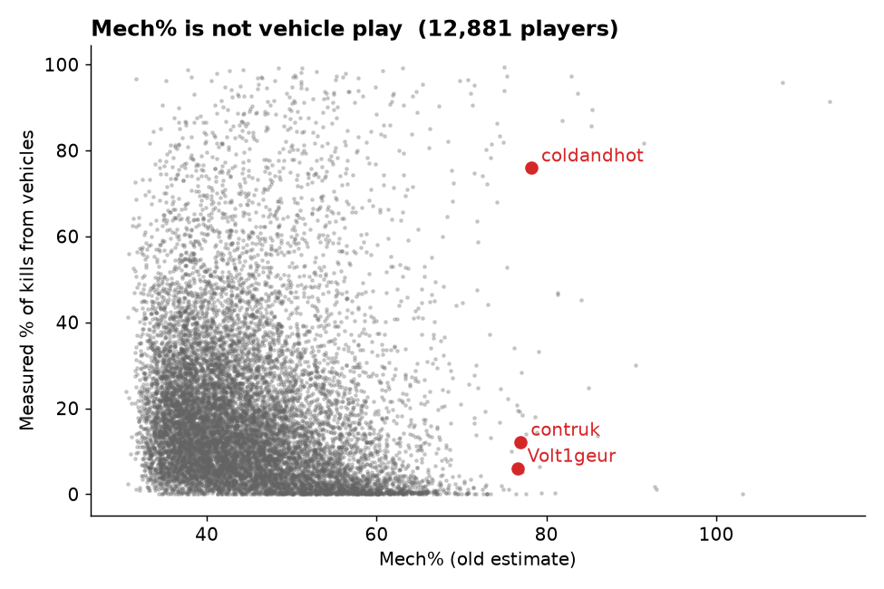
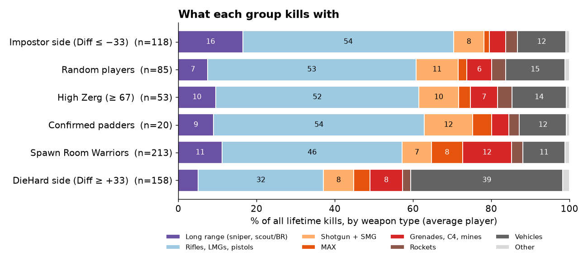
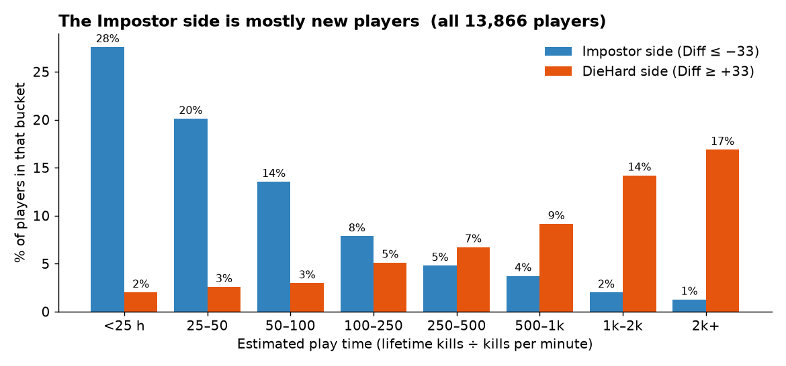
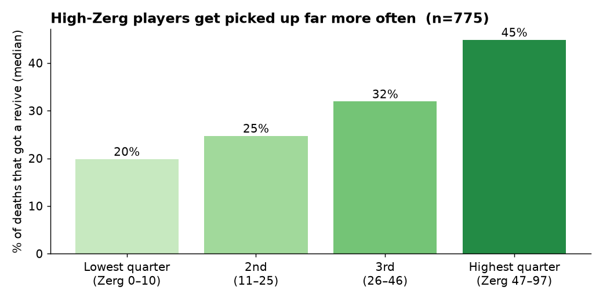

# Theory vs Practice — the 🔀 Diff column: compiled knowledge

Compiled 2026-10-21 from the design dialogue and measurements of that day.
Audience: other agents (Claude, batch workers) picking up ps2-elite-kd work.
Population for every number below: data/ranks.json, 2026-10-21 ~20:44Z,
13,406 players with both IvI and ⚔️ iVi (thin samples excluded by shownValue).

## 1. The framing

The skill graph has two views, and they are two different kinds of skill:

- **💀 K/D mode — PRACTICE.** "Who wins fights": the realized K/D curve
  against easy → hard enemies. Positioning, fight selection, opposition
  quality — everything that actually happens is inside this number.
- **🎯 iVi mode — THEORY.** "Who aims best IN THEORY" (owner wording,
  shipped 2026-10-21, commit 14fc8790): each line keeps its shape but is
  placed at the player's aim score, public IvI = accuracy × headshot %.
  Pure mechanics — what the aim would do in a vacuum. The tip says it
  outright: "better aim, not more wins."

Owner's summary of the pair: theoretical and practical side of the skill.
Players swapping places between the views is the visible form of the gap.

## 2. The 🔀 Diff column (shipped 2026-10-21, commit 302dde1f)

Owner's design call, in his words: "show just practical graph + numbers
for the theoretical difference" — the practical view stays the canvas; the
only theoretical artifact is one number.

- **Definition (fixed, never view-relative):**
  Diff = percentile(⚔️ iVi) − percentile(public IvI), percentile = the
  site's floored share-below (dist.mjs percentileOf). Range −99…+99.
  Positive = results outrun aim. Negative = aim doesn't convert.
  It deliberately does NOT flip sign in the 🎯 view (owner was offered
  the flip; the fixed version was chosen — "Build it as proposed").
- **Placement:** last column of the stats table's DEBUG group
  (adjDebugCols in app.js, after 🎈 Inflation), behind the existing
  "show older debug stats" toggle. Stats table only — Rankings untouched.
- **Plumbing:** both pools come from data/ranks-lite.json. build-ranks.mjs
  LITE_COLS gained "ivi" (appended; all consumers look columns up by name).
  app.js loadConsPool() builds adjsPool + iviPool; the column fn returns
  NaN (cell "—") until a lite payload with ivi arrives. Custom diffCell
  renderer: signed value, no relative-% suffix, hover shows both
  percentiles ("Practice ⚔️ percentile {a} − theory IvI percentile {i}").
- **i18n:** keys col.diff ("🔀 Diff"), tip.diff, diff.cell in en.json;
  other locales fall back to English. Retranslation = issue #54.
  (Sibling change: chart.modeAim / chart.modeAimTip "IN THEORY" wording,
  popup bold via head-tip.mjs ** parsing — issue #53.)

## 3. Measured findings (2026-10-21)

### Reference names (Const = ⚡ percentile [raw ratio]; Diff = ⚔️ pct − IvI pct)

| Player | ⚡ Const | Theory | Practice | Diff |
|---|---|---|---|---|
| Gleerp | 86 [0.75] | 99 | 0 | −99 |
| Andarethh | 94 [1.00] | 95 | 5 | −90 |
| GingerBabyNCE | 27 [0.46] | 2 | 94 | +92 |
| Volt1geur | 37 [0.50] | 9 | 99 | +90 |
| ShloDog | 69 [0.63] | 30 | 59 | +29 |
| Sluglip | 0 [0.18] | 57 | 84 | +27 |
| Artofdying | 90 [0.84] | 94 | 99 | +5 |
| xCloneKano | 54 [0.57] | 97 | 99 | +2 |
| Zugie | 33 [0.49] | 97 | 96 | −1 |
| Simplenubb | 71 [0.64] | 99 | 99 | 0 |

All ten reproduce live in the shipped column (harness-verified).

### The top 1% (n=134 each way)

- By ⚔️: median Diff +2, SD 8.7. Only 4 players |Diff| ≥ 20, one ≥ 40.
- By IvI: median Diff −1, SD 14.5. 16 players ≤ −20, six ≤ −40.
- **Overlap: only 42 of 134 are in both top-1% lists.** At the very top,
  "best aim" and "best results" are largely different populations.
- **Asymmetry:** aim is nearly necessary but far from sufficient.
  Only 6/134 practice-elite have theory below pct 90 (1 below 50);
  27/134 theory-elite fall below practice pct 90 (2 below the median).

### Middle and bottom (owner's prior — confirmed)

- Middle band (⚔️ pct 45–55, n=1,475): SD 23.4; half have |Diff| ≥ 20.
- Bottom 10% by ⚔️ (n=1,341): SD 20.2, median −11; 209 players ≤ −40.
- Caveat: part of the top's calm is arithmetic — at pct 99 the gap can
  only point one way, so it is capped by construction. The asymmetry
  and the 42/134 overlap are NOT arithmetic.

### The tails

- **Positive tail (Diff ≥ +40, n=615):** Mech% median 52 (population 43);
  at the very top (+85…+92) Mech 52–77. Practice far beyond aim.
  (Note 2026-10-22: Mech% is not a vehicle measure — see §4.2.)
- **Negative tail (Diff ≤ −40, n=850 — the larger tail):** Mech% median
  36 (infantry), and the five most extreme all have RF (🦁 Brave factor)
  0.06–0.13 — their results collapse specifically against strong
  opposition. Aim sheets that real fights don't honor.
- Inflation medians are ~equal in both tails (2.1) — Diff is orthogonal
  to 🎈 Inflation.

## 4. Which impostors does Diff catch? (the owner's question)

Ranked by what the data shows:

1. **Chart impostors — YES, most of all.** The negative tail (850
   players) is the biggest catch: elite IvI on paper, collapsed realized
   rating. Type specimens: Gleerp (IvI 1,532 p99 → ⚔️ −1,359 p0),
   PerfectAdene (−92), AzimGirl (−91), Andarethh (−90, with Const 1.00 —
   perfectly consistent, just outclassed), Adsweqtt (−88),
   Sheldon3945 (IvI 1,803, ⚔️ −296, ⚡ Const 0.21 — K/D collapses
   against the hard third; consistency explains the non-conversion).
2. **Hidden vehicle mains — PARTLY (corrected 2026-10-22).** The first
   version of this note used Mech% as a "vehicle play" sign. That was wrong:
   Mech% does not measure vehicles. Against the measured share of kills
   made from vehicles (player.infantry, 12,881 players) it goes slightly the
   OTHER way (rank correlation −0.23). The two "extremes" named here were
   in fact infantry players: **Volt1geur 94% of kills on foot, contruk 88%**.
   coldandhot (76% vehicle kills) is a real vehicle main.
   What still holds, now on measured data: the DieHard side does lean on
   vehicles. Of players with Diff ≥ +33, **59% get ≥ 30% of kills from
   vehicles**, vs 20% in the middle band and 8% on the Impostor side
   (Diff vs vehicle share: +0.32). In the weapon sample (§7) vehicles are
   39% of DieHard kills vs 15% for random players. So: vehicle play explains
   a lot of the positive side, but the very top of it is mostly infantry.
   
3. **Zerg surfers — NO.** Top-5% 🎈 Inflation players (n=670) have
   median Diff −4: no signal. Reason: ⚔️ already strips the
   soft-opposition advantage, so their practice and theory sink
   together. Zerg surfing stays Inflation's job (proof case: Bhorn —
   Inflation 3.58 from pure fight selection, Diff exactly 0, theory and
   practice agree at pct 89).

**Diff is not a cheat flag.** The known "peakie" sheets are invisible to
it because their theory and practice agree: Aekris Diff +1, Omegadude1234
+1, Zyr0s +1, DizzyKnight +4, ShrimpeHx 0 — whatever those sheets are,
Diff neither convicts nor clears them. It measures CONVERSION, not
honesty. (And a 0 Diff for xCloneKano/Simplenubb/Zugie, the legit
controls, is the sanity check that the measure is wired right.)

## 5. Caveats for anyone reusing these numbers

- Percentiles are floored shares over slightly different pools
  (IvI exists for ~45 more players than ⚔️); gaps of ±1–2 are noise.
- ⚔️ can go negative (speed cut + penalties), which stretches the
  bottom of the practice scale — Diff −99 is partly that floor.
- Mid-pack percentile gaps compress raw differences: ±10 around the
  median is small; the measure speaks at the extremes.
- Diff is computed from the lite payload (values rounded: adjs/ivi to
  0.1); full-ranks recomputation agrees within ±1 on every checked name.

## 6. Open questions for other agents

- **Diff × RF screen:** the negative tail's RF is 0.06–0.13. Does
  Diff ≤ −40 AND RF < 0.2 isolate "aim that can't handle strong
  opponents" as a named, explainable class (a Sheldon3945 detector)?
- **Diff × Const:** Sheldon3945 (Const 0.21) vs Andarethh (Const 1.00)
  are both ~−90 but for opposite reasons — collapse vs uniform
  outclassing. Worth separating in any future display?
- **Infantry-only Diff for vehicle mains:** the positive tail is
  "explained" by Mech%, but there is no infantry-only practice
  percentile to compare their IvI against. Would need an
  infantry-restricted ⚔️ variant — does the data support one?
- **Promotion path:** if Diff proves itself in debug use, candidates
  are the Rankings table (needs a ranks.json column — build-time, both
  percentiles exist there) and the columns.html debug section write-up.
- **Zerg joint signature:** Inflation catches surfers alone today; is
  there a joint Inflation × slope/Const pattern that separates
  "surfs zergs" from "farms soft fights solo"? Bhorn is the seed case.

---

# Update 2026-10-22 — weapons, 🛖, and a map of odd finds

Data for everything below: data/ranks.json of 2026-10-23 03:09Z
(13,960 players), player files (infantry split, assists, Honu XP for
1,211 players), and full Census weapon stats (every weapon, not only
auraxiums) for **648 players**: all 213 🛖, 158 DieHard side, 118
Impostor side, 85 random players, 53 high-Zerg, 20 confirmed padders.
"Long range" = sniper + scout/battle rifle kills. Medians unless noted.

## 7. Weapons — what each group kills with

- **DieHard side (Diff ≥ +33): vehicles.** 39% of kills from vehicles
  (random players 15%). Half of them (49%) get ≥ 30% of kills that way.
  Aim stats can't see those kills, which is why practice beats theory.
- **Grenades push Diff up.** Of all weapon types, the share of kills from
  grenades / C4 / mines is the best single predictor of a high Diff
  (rank correlation +0.39). Split the non-🛖 sample into four equal parts
  by explosive share: median Diff goes −10 → −1 → +18 → +31.
  Grenade kills count as results but not as aim.
- **Impostor side (Diff ≤ −33): one gun, often the free one.** 91% have
  zero auraxiums, 38% get ≥ 40% of all kills from one weapon (random
  players 14%), and for 36% the top weapon is a starter gun
  (AF-19 Mercenary, TRAC-5, Solstice, T9 CARV, Orion, Pulsar...; random
  players 18%, DieHard 6%). They also snipe the most: 29% get ≥ 20% of
  kills at long range (random 8%).
- **🛖 Spawn Room Warriors: explosives and MAX, not sniping.** 27% get
  ≥ 15% of kills from grenades/C4/mines (random 8%); MAX 8% of kills vs
  2% for random players. Long range is only a mild lean: 15% have ≥ 20% long-range kills
  (random 8%, DieHard 2%). The earlier "22% vs 7–8%" was on a smaller
  sample; the new number is 15% vs 8%. No 🛖 player has ≥ 30% vehicle
  kills — expected, the gate requires infantry play.
- **The sniper-vs-camper split is now possible** (all weapons stored):
  32 of 213 🛖 are long-range heavy (e.g. goldenpine 73% sniper kills,
  Brenkles 68%); the other 181 are close/explosive. Two different kinds
  of "safe spot" player.
- **GingerBaby family: 26–53% of kills from grenades** (confirmed:
  GingerBaby 26%, GingerBabyEU 41%, GingerBabyEUNC 44%,
  GingerBabyVSE 44%, GingerBabyNCE 53% incl. Love Bomber grenades).
- **alvinkepp: close range** — 52% shotgun/SMG/AI MAX (Pandora VX25 top).
- **Auraxiums mostly measure play time.** Auraxium count vs estimated
  play time: rank correlation **+0.88**. So a big auraxium count is not a
  skill sign by itself.
- **Confirmed padders auraxium ~3× faster.** Median 47 auraxiums, at
  1.3 per 100 h of play vs 0.46 for other players with 500 h+. They also
  spread kills thin (top weapon only 13% of kills — they grind every gun)
  and almost never use NS weapons (0.1% of kills on average vs 4–8% for the other groups).
- **No faction lean.** Home faction split (VS/NC/TR) is about a third
  each in every group; NS weapon use is low (median ~0%) everywhere.
- **🪳 Zerg vs weapons: nothing strong.** High-Zerg players use slightly
  more grenades (+0.31) and fewer vehicles; their weapon mix is close to
  random players.

## 8. 🛖 Spawn Room Warrior (shipped 2026-10-22)

- **Gate (all cut points from the data):** deaths/min p10→p20
  (0.164→0.215), infantry share 75→85%, accuracy median→p60
  (20.22→21.90%), Activity cut = median 0.2717 × (1.333 + 6.667 × iVi
  percentile/100 × experience), experience ramps over play time p5→p25
  (~6 h → ~62 h). Only a positive Diff is reduced.
- **Marked now: 217 players** (Diff drop ≥ 10; 476 get some reduction).
  Of the 1,180 players with raw Diff ≥ +33, 118 are 🛖; after damping,
  1,055 stay ≥ +33.
- **Biggest drops:** the GingerBaby family (VSE 87→15, NCE 92→20,
  EUNC 79→11, EU 78→11, GingerBaby 69→10), then SobokSobok 65→6,
  GeMul 62→5, Mindlessdoomer 62→5, BadBotanist 59→1.
- **Named checks:** Offtopia 57→16, SittingDuck66 28→2,
  RubberDuckAndCover 34→11, JustV6me untouched (14).
- **🛖 often comes with high Zerg:** median 🪳 Zerg 60 for marked
  players vs 31 overall — but 16 of the 90 with a Zerg score are ≤ 20,
  so a low-Zerg 🛖 does exist (solo safe-spot players).
- **Early hint, small sample (12 🛖 with Honu XP):** 7 of 12 revive 10+
  players per hour (median 14.5/h; non-🛖 median 0.2/h, only 15% reach
  10/h). Many 🛖 may be medics working from cover. Needs more XP data.

## 9. Do the columns repeat each other? (correlation check)

- The core skill columns — iVi, Activity, Brave, Resist, K/D, public KD
  — all correlate **0.9 or more** with each other: they are views of the
  same thing.
- Debug Mech%, COI and ivi are copies of Resist.
- The new **🔀 Diff and 🪳 Zerg are NOT copies** of anything — they add
  new information. Nothing was removed.

## 10. Map of odd finds (quietly collected data)

1. **The Impostor side is mostly new players.** Across all 13,866
   players, Diff vs estimated play time is +0.47. 62% of the 🤥 side have
   under ~50 h (median 28 h); the 😤 side median is ~1,400 h. Under 25 h,
   28% of players are on the 🤥 side; at 2,000 h+, only 1%. So a strong
   negative Diff mostly means "new, not converting yet", not a fake sheet.
   
2. **🪳 Zerg is confirmed by data it never uses.** Zerg is built from
   Inflation and assists only — yet high-Zerg players get revived after
   far more of their deaths: 20% → 25% → 32% → **45%** from the lowest to
   the highest Zerg quarter (775 players with Honu XP; correlation +0.47).
   Riding a big group = medics nearby.
   
3. **Zerg players rarely "dominate".** Domination kills (killing the
   same enemy again and again) per kill fall from 10.6% to 6.6% from the
   lowest to the highest Zerg quarter (−0.40). Kills are spread across a
   crowd, not taken from one opponent.
4. **Weak players get more revenge kills.** Revenge kills per kill go
   with lower K/D (−0.52) and lower Brave (−0.51): you only get revenge
   after dying, so this is a "dies a lot" marker, not a skill one.
5. **XP headshots line up with the Diff sign.** Headshot XP events per
   kill go DOWN as Diff goes up (−0.54 over 775 players; 😤 side median
   0.19 per kill vs 0.35 in the middle) —
   a check from a separate data source (Honu XP) that IvI's headshot part
   is what pulls the Impostor side's "theory" up.
6. **Grenades are the hidden Diff booster** (§7): the top quarter by
   explosive share sits at median Diff +31, the bottom quarter at −10.

Caveats: play time is estimated (lifetime kills ÷ KPM) and can be off for
very low-KPM players; the weapon sample is targeted (not random) except the
85 random players; XP data covers 1,211 players (775 with 100+ kills).
